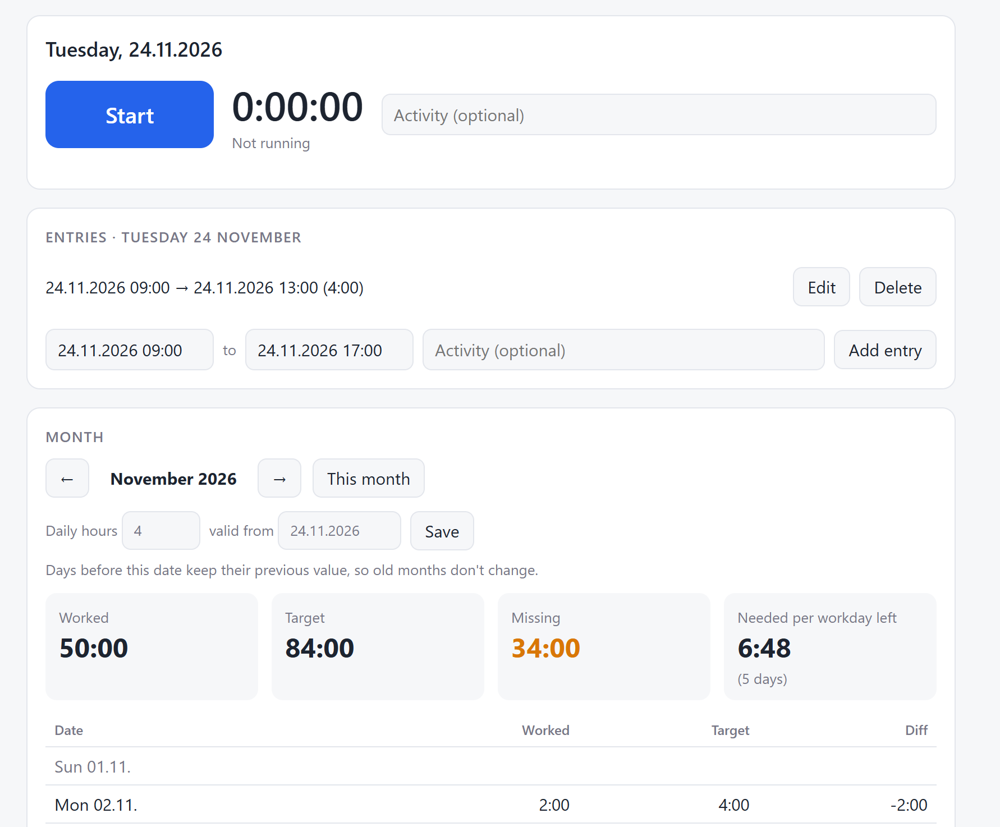

# TimeTracker

[](https://github.com/kacaben/TimeTracker/actions/workflows/tests.yml)

Personal start/stop time tracker. Python standard library only (no `pip install`), SQLite storage, single-page UI.



- One-click start/stop timer, manual entries, editing, per-day entry list.
- Monthly overview: worked vs. target hours, overtime, and hours needed per remaining workday.
- Daily-hours target with history: a change applies from a chosen date, past months stay as they were.
- Runs fully offline on your own PC; data stays in a local SQLite file.

Requires Python 3.8+ and a modern browser.

Open **http://localhost:8765** in a browser. The server listens on `127.0.0.1` only (this PC).

## Run manually

Double-click `start.bat`, or:

```powershell
python server.py
```

Settings via environment variables: `TT_PORT` (default `8765`), `TT_DB` (default `timetracker.db` next to `server.py`), `TT_LOG` (default `timetracker.log` next to `server.py`).

`start.bat` is for Windows; on macOS/Linux run `python3 server.py` and open the URL.

## Start automatically with Windows

A shortcut `TimeTracker.lnk` in the Startup folder runs `pythonw.exe server.py` at login, with no console window.

- Open the Startup folder: press `Win+R`, type `shell:startup`, Enter.
- The shortcut target is `pythonw.exe` (next to `python.exe`), arguments `server.py`, start in this project folder.
- If you move the project folder or reinstall Python, update the shortcut (or recreate it).

To recreate it:

```powershell
$dir = "C:\path\to\TimeTracker"   # this project folder
$pyw = Join-Path (Split-Path (Get-Command python).Source) "pythonw.exe"
$s = (New-Object -ComObject WScript.Shell).CreateShortcut((Join-Path ([Environment]::GetFolderPath("Startup")) "TimeTracker.lnk"))
$s.TargetPath = $pyw; $s.Arguments = "server.py"; $s.WorkingDirectory = $dir; $s.WindowStyle = 7; $s.Save()
```

### Disable autostart

Delete the shortcut (takes effect at next login):

```powershell
Remove-Item (Join-Path ([Environment]::GetFolderPath("Startup")) "TimeTracker.lnk")
```

### Stop the running server

It runs hidden, so end the process listening on the port:

```powershell
Stop-Process -Id (Get-NetTCPConnection -LocalPort 8765 -State Listen).OwningProcess -Force
```

The server does not restart by itself until the next login or a manual start. Stopping it does not stop a running timer: the timer is stored in the database and keeps counting from its start time.

## Tests

```powershell
python -m unittest discover -s tests -v
```

Standard library only. The daylight-saving test is skipped when the local time zone has no DST; CI runs it with `TZ=Europe/Prague`.

## Security

Meant for a single user on their own PC:

- Listens on `127.0.0.1` only, and answers only requests addressed to `localhost` (blocks DNS rebinding).
- Write requests must be JSON and may not come from a foreign `Origin`, so other websites cannot change your data.
- No login: any program or user on the same PC can reach the API. Do not expose the port to a network.
- Unexpected errors are written to `timetracker.log` next to `server.py` (override with `TT_LOG`).

## Data and backup

All data is in `timetracker.db` (SQLite) in this folder. Back up that file.

## Notes

- Dates are entered as `DD.MM.YYYY HH:MM` (calendar popup via flatpickr).
- Holidays count as workdays; weekend work counts as worked time but adds no target.
- Daily hours changes apply from the chosen date onward; earlier days keep their previous value.
- Date picker library: flatpickr 4.6.13 (MIT), stored in `vendor/flatpickr/` so the app works offline.
- Entries must be between the years 2000 and 2100 and at most 7 days long (catches typos).

## License

MIT, see [LICENSE](LICENSE). flatpickr is MIT-licensed by its authors, see [vendor/flatpickr/LICENSE](vendor/flatpickr/LICENSE).
